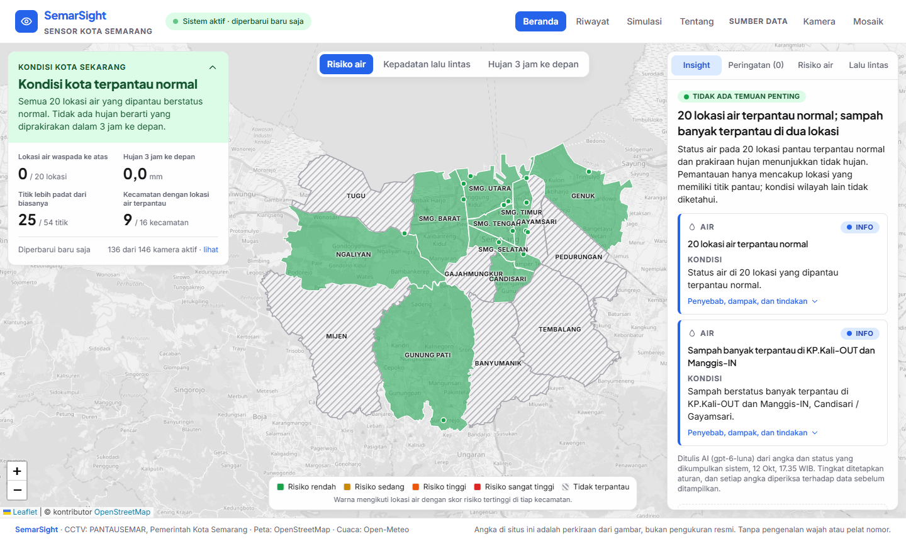
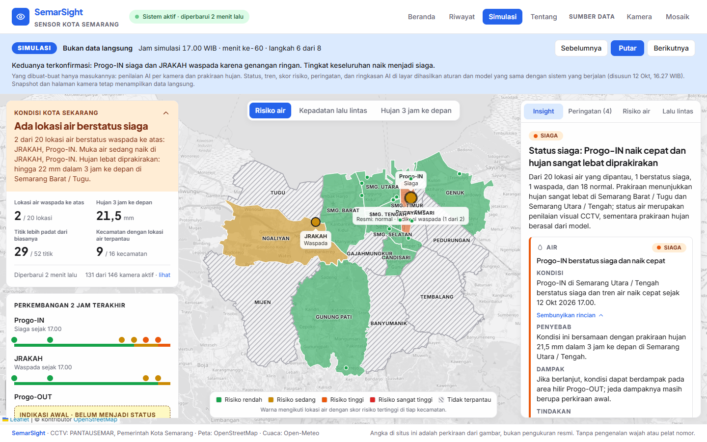
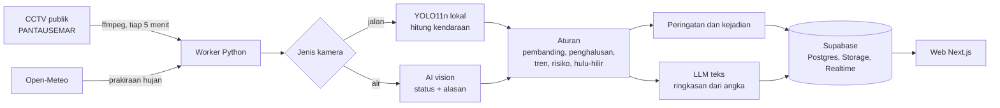

# SemarSight

CCTV publik Kota Semarang sebagai sensor kota. SemarSight membaca kondisi **air** (sungai, pompa, genangan) dan **kepadatan lalu lintas** dari gambar CCTV, menghubungkannya dengan prakiraan hujan, lalu menampilkan kondisi per kecamatan beserta peringatan dan saran tindakan. Kamera adalah buktinya; yang ditonjolkan adalah kondisi wilayah.

Proyek lomba **ICONFEST 2026, Software Development, tema Smart City**.



> **Status (12 Oktober 2026).** Worker merekam 146 kamera tiap 5 menit; 20 lokasi air dinilai AI. Status, tren, skor risiko, hubungan hulu–hilir, peringatan, pencatatan kejadian, dan ringkasan AI berjalan. Web berjalan lokal dan belum di-deploy. Sejak sistem berjalan (10 Oktober) belum pernah ada kejadian air naik yang nyata, jadi alur kejadian diperlihatkan lewat halaman simulasi. Progres rinci: [docs/10-tasklist.md](docs/10-tasklist.md).

## Yang dilakukan sistem

- **Memantau 146 CCTV publik** tiap 5 menit dan mencatat mana yang hidup, beku, atau mati. Kamera yang tidak terbaca tidak pernah dianggap normal.
- **Menilai 20 lokasi air.** AI vision membandingkan muka air dengan garis acuan dan foto kondisi normal. Hasilnya status `normal`, `waspada`, `siaga`, atau `awas`, bukan tinggi air dalam cm.
- **Menghitung kepadatan lalu lintas** dengan YOLO11n yang berjalan lokal, sebagai indeks relatif terhadap titik itu sendiri pada jam yang sama di hari-hari sebelumnya.
- **Menggabungkan dengan prakiraan hujan** Open-Meteo menjadi skor risiko terbuka per lokasi (status 40%, tren 20%, kondisi hulu 20%, hujan 20%).
- **Memberi peringatan** dari aturan dan template: air naik, jalan tergenang, peringatan dini untuk lokasi hilir, hujan lebat, sampah menumpuk sebelum hujan, dan kamera unggulan tidak terbaca.
- **Menjelaskan dengan AI.** Kartu berpola Kondisi → Penyebab → Dampak → Tindakan ditulis LLM dari angka dan status, dengan saran per pihak (BPBD, Dinas PU, Dishub, warga).
- **Mencatat kejadian**: kapan sebuah lokasi naik, puncaknya, dan berapa lama sampai kembali normal.

## Prinsip rancangan

**AI untuk melihat dan menjelaskan, aturan untuk memutuskan.**

- Satu penilaian AI tidak pernah langsung menjadi status. Status resmi naik setelah dua penilaian sepakat dan turun setelah tiga.
- Penilaian yang hasilnya naik diulang sekali atas gambar yang sama, dan baru dihitung bila keduanya sepakat. Penilaian berkeyakinan rendah hanya menandai "perlu diperiksa".
- Tingkat keseluruhan kota dihitung aturan, lalu menimpa apa pun yang ditulis LLM. Setiap angka di tulisan LLM diperiksa terhadap data; yang tidak cocok dibuang sebelum disimpan.
- Semua keluaran AI berupa JSON terstruktur yang divalidasi (Pydantic di worker, Zod di web). Jawaban yang tidak valid disimpan sebagai "tidak dapat dinilai".

**Jujur soal batas.** Layar tidak menampilkan angka yang tidak dikumpulkan sistem (tinggi air, kecepatan, debit). Wilayah tanpa kamera ditandai "tidak terpantau", bukan aman. Keyakinan AI dan waktu data selalu ditampilkan.

**Hemat.** AI vision dipanggil hanya saat gambar berubah nyata, saat hujan, atau tiap 30 menit, dengan potongan gambar selebar 512 px. LLM teks dipanggil hanya saat keadaan berubah. Satu penilaian air sekitar $0,0003; satu ringkasan sekitar $0,001.



## Arsitektur



Worker berjalan di satu mesin yang menetap (tidak bisa berjalan di Vercel); web membaca Supabase dengan kunci publik dan berlangganan Realtime. Kunci rahasia hanya ada di worker dan di server Next.js. Rinciannya di [docs/02-architecture.md](docs/02-architecture.md).

## Halaman

| Rute | Isi |
|---|---|
| `/` | **Beranda.** Peta penuh per kecamatan dengan tiga tema (risiko air, kepadatan lalu lintas, hujan 3 jam ke depan). Kiri: kondisi kota dari aturan, dan linimasa lokasi yang sedang bergerak. Kanan: ringkasan AI, peringatan, peringkat lokasi, atau rincian kecamatan yang dipilih (termasuk tren 24 jam). |
| `/simulasi` | **Simulasi kejadian.** Skenario air naik delapan langkah di layar yang sama dengan beranda, berlabel "SIMULASI · Bukan data langsung". Hanya masukannya yang buatan; status, peringatan, dan ringkasan AI dihasilkan aturan dan model yang sama dengan sistem. |
| `/lalu-lintas` | **Lalu lintas dari dekat**, tiga lapisan di satu peta. *Ruas jalan*: potongan jalan di sekitar tiap kamera, berwarna tingkat kepadatan dibanding kebiasaannya. *Aktivitas per jam*: heksagon dengan penggeser jam, dari rata-rata hitungan yang sudah terkumpul. *Beban emisi*: estimasi relatif per ruas dari kendaraan terlihat dan faktor emisi resmi, bukan kg per jam. |
| `/riwayat` | Kejadian yang tercatat (mulai, puncak, lama) dengan unduhan CSV. |
| `/tentang` | Cara kerja, batasan, privasi, dan sumber data. |
| `/kamera/[id]` | **Bukti visual** satu lokasi: gambar terakhir dengan garis acuan, penilaian AI dan alasannya, pembanding kondisi normal, gambar yang dinilai sebelumnya, rincian skor risiko, dan grafik kepadatan. |
| `/kamera`, `/mosaik` | Peta dan grid semua kamera sumber data. |
| `/admin/kamera`, `/admin/kalibrasi/[id]` | Memilih kamera unggulan dan mengkalibrasi kamera air: area pengamatan, garis acuan, foto referensi siang dan malam. |

Lencana di header menunjukkan apakah worker masih aktif; banner muncul bila worker tidak terlihat lebih dari 15 menit.

## Struktur repo

```
ai/schemas/     JSON schema keluaran AI (penilaian air, insight)
data/           daftar 146 kamera publik (seed)
docs/           brief, arsitektur, spesifikasi, catatan keputusan, tasklist
scripts/        skrip bantu Windows: menyalakan worker dan web, mencegah mesin tidur
supabase/       skema database dan seed kamera
web/            Next.js (App Router), TypeScript, Tailwind, react-leaflet, Recharts
worker/         Python: akuisisi, YOLO, AI vision, aturan, peringatan, kejadian, insight
```

## Menjalankan

### Prasyarat

- Proyek Supabase yang sudah menjalankan `supabase/schema.sql` lalu `supabase/seed_cameras.sql`.
- Kunci API OpenAI, dan nama model yang mendukung input gambar serta structured outputs.
- Python 3.11 ke atas, Node.js 20 ke atas, dan ffmpeg di `PATH`.

### Konfigurasi

Salin `.env.example` menjadi `.env` (worker) dan `web/.env.local` (web), lalu isi nilainya. Berkas berisi nilai asli tidak boleh di-commit.

| Variabel | Dipakai | Keterangan |
|---|---|---|
| `NEXT_PUBLIC_SUPABASE_URL`, `NEXT_PUBLIC_SUPABASE_ANON_KEY` | web | Satu-satunya nilai yang sampai ke browser; RLS hanya mengizinkan baca |
| `SUPABASE_URL`, `SUPABASE_SERVICE_ROLE_KEY` | worker, server web | **Rahasia.** Akses tulis |
| `OPENAI_API_KEY`, `OPENAI_VISION_MODEL`, `OPENAI_TEXT_MODEL` | worker | **Rahasia.** Model diatur lewat env, tidak ditulis di kode |
| `ADMIN_PASSWORD`, `ADMIN_SESSION_SECRET` | server web | **Rahasia.** Untuk halaman admin |
| `FRAMES_DIR`, `FRAMES_RETENTION_DAYS` | worker | Arsip gambar lokal, ±7,5 GB per hari, dihapus otomatis setelah 14 hari |
| `CYCLE_SECONDS`, `WATER_HEARTBEAT_MINUTES`, `AI_DAILY_CALL_CAP`, dan lainnya | worker | Nilai bawaan sudah sesuai; lihat `.env.example` |

### Worker

```bash
cd worker
python -m venv .venv
source .venv/bin/activate          # Windows: .venv\Scripts\activate
pip install -r requirements.txt
pip install --no-deps ultralytics==8.4.175   # terpisah agar tidak menimpa OpenCV headless

python -m semarsight_worker.main --once --limit 3 --dry-run --verbose   # uji tanpa menulis apa pun
python -m semarsight_worker.main                                        # jalan terus, siklus tiap 5 menit
```

**Hanya satu worker yang boleh berjalan.** Dua worker membuat data ganda dan biaya AI dobel.

### Web

```bash
cd web
npm install
npm run dev                  # http://localhost:3000
npm run lint && npm run build
```

### Di Windows

```powershell
powershell -ExecutionPolicy Bypass -File scripts\windows\mulai-worker.ps1        # jendela sendiri, menyala ulang otomatis
powershell -ExecutionPolicy Bypass -File scripts\windows\muat-ulang-worker.ps1   # setelah kode worker berubah
powershell -ExecutionPolicy Bypass -File scripts\windows\mulai-web.ps1           # build lalu jalan di localhost:3000
```

Cara menyiapkan mesin baru, memindahkan worker, dan masalah yang pernah terjadi ada di [docs/14-operasional.md](docs/14-operasional.md).

## Uji dan alat periksa

```bash
cd worker
pytest                                             # 182 unit test: aturan, peringatan, kejadian, insight, ruas jalan
python scripts/status.py                           # detak worker, 20 lokasi air, peringatan, jeda data
python scripts/calibration_check.py                # kalibrasi tiap kamera air; yang perlu dilihat ditulis lebih dulu
python scripts/replay_readings.py --all 3          # nilai ulang gambar bukti tersimpan dengan kalibrasi dan prompt saat ini
python scripts/probe_camera.py "JRAKAH"            # uji penilaian AI satu kamera
python scripts/probe_insight.py naik               # uji ringkasan AI pada keadaan buatan
python scripts/build_demo_scenario.py --no-llm     # jalankan skenario simulasi melalui aturan asli
python scripts/build_road_segments.py              # bangun ulang ruas jalan halaman Lalu Lintas dari OpenStreetMap
```

Semua skrip di atas tidak menulis ke database. `replay_readings.py` dipakai setiap kali kalibrasi atau prompt diubah, untuk memastikan salah baca yang pernah terjadi tidak terulang dan lokasi lain tidak ikut berubah.

## Keterbatasan

- **Tidak mengukur tinggi air** dan **tidak menghitung kendaraan secara presisi**. Yang ditampilkan adalah status, indeks relatif, dan skor risiko. Sepeda motor, terutama malam hari, banyak yang tidak terdeteksi.
- **Belum ada kejadian nyata.** Aturan, peringatan, dan tampilannya sudah diuji, tetapi ketepatan AI membaca gambar saat banjir sungguhan belum terbukti.
- **Belum ada evaluasi akurasi dengan label manusia**, baik siang maupun malam.
- **Cakupan tidak merata.** Lokasi air baru terpantau di 9 dari 16 kecamatan; dua kecamatan tidak punya kamera publik sama sekali.
- **Pembanding lalu lintas masih sementara** sampai ada tiga hari data sejenis; deteksi anomali menyala setelah itu.
- **Penilaian AI tidak selalu sama bila diulang** pada gambar yang sulit (busa pompa, kamera melawan cahaya). Aturan dua-penilaian dan penilaian ganda dibuat untuk itu, tetapi lokasi seperti itu tetap perlu dipantau.
- **Hubungan hulu–hilir** baru diisi untuk empat rumah pompa, dengan jeda waktu yang masih perkiraan awal.
- **Prakiraan hujan** berasal dari model Open-Meteo, bukan pengukuran di lokasi.

## Privasi

Hanya CCTV publik milik pemerintah kota yang dipakai; kamera lingkungan RT/RW tidak. Tidak ada pengenalan wajah dan tidak ada pembacaan pelat nomor. Yang disimpan jangka panjang hanya angka. Gambar yang dinilai AI disimpan 3 hari supaya penilaiannya bisa diperiksa, lalu dihapus otomatis.

## Sumber data

| Data | Sumber |
|---|---|
| Gambar CCTV | PANTAUSEMAR, Pemerintah Kota Semarang |
| Prakiraan hujan | [Open-Meteo](https://open-meteo.com/) |
| Peta, jalan, dan batas kecamatan | © kontributor [OpenStreetMap](https://www.openstreetmap.org/copyright), lisensi ODbL |

Angka di situs ini adalah perkiraan dari gambar, bukan pengukuran resmi, dan tidak menggantikan informasi dari BPBD atau BMKG.

## Dokumentasi

| Dokumen | Isi |
|---|---|
| [docs/01-project-brief.md](docs/01-project-brief.md) | Masalah, solusi, pengguna, nilai unik |
| [docs/02-architecture.md](docs/02-architecture.md) | Alur dari CCTV sampai web |
| [docs/05-worker-spec.md](docs/05-worker-spec.md), [docs/06-web-spec.md](docs/06-web-spec.md) | Spesifikasi worker dan web, termasuk yang sudah dibangun |
| [docs/07-ai-prompts.md](docs/07-ai-prompts.md) | Prompt, schema, dan pemeriksaan keluaran AI |
| [docs/13-catatan-keputusan.md](docs/13-catatan-keputusan.md) | Keputusan yang diambil beserta alasan dan buktinya, pelajaran kalibrasi |
| [docs/14-operasional.md](docs/14-operasional.md) | Menyiapkan mesin, menjalankan, memeriksa, memindahkan worker |
| [docs/10-tasklist.md](docs/10-tasklist.md) | Daftar tugas, progres, dan tabel kalibrasi per kamera |
